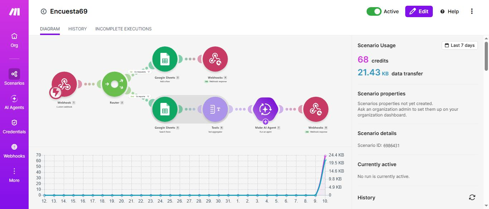
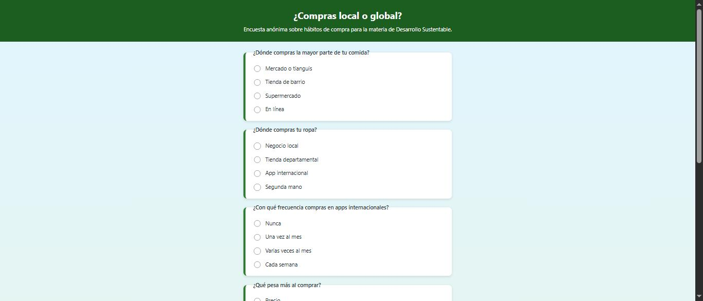
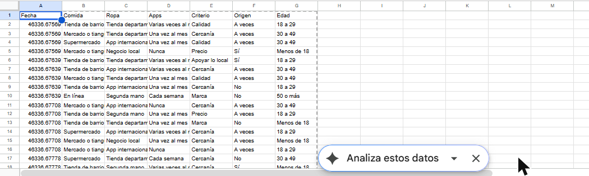
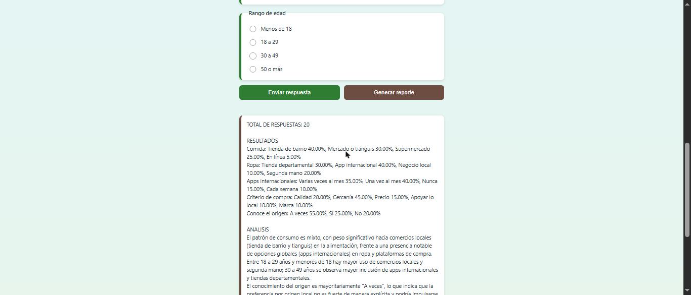
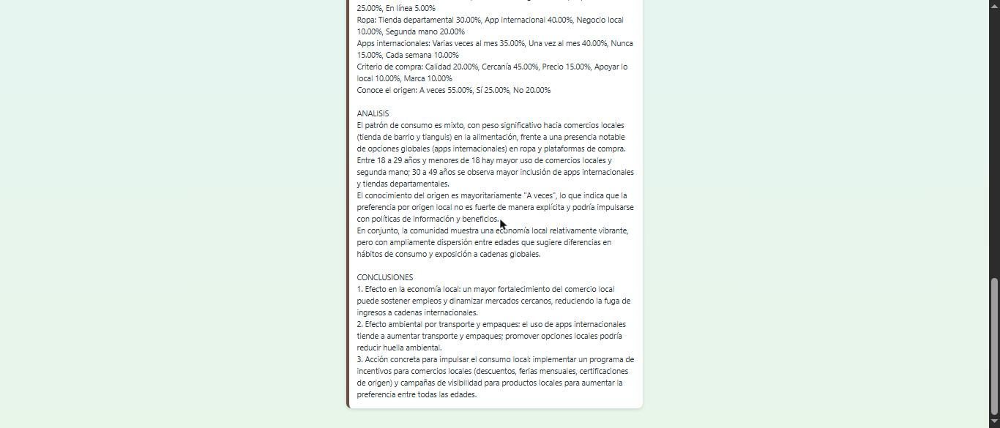
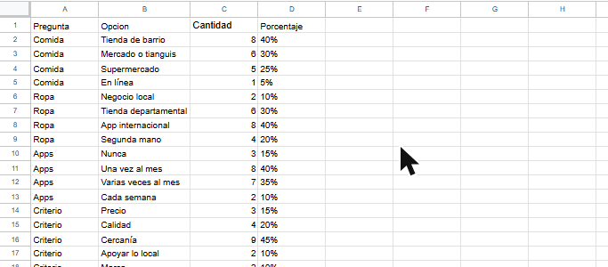
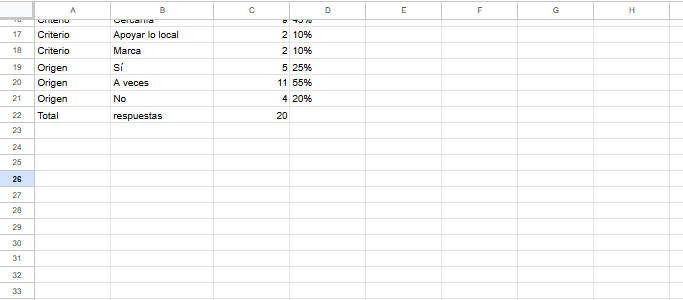

# Práctica 4.2 – Encuesta "¿Compras local o global?"

| Dato | Valor |
|---|---|
| Estudiante | Roberto Carlos Robles Campos |
| Escuela | Tecnológico Nacional de México – Instituto Tecnológico de Mazatlán |
| Materia | Desarrollo Sustentable (ACD-0908) |
| Práctica | 4.2-P8 Encuesta "¿Compras local o global?" |

**Página de la encuesta:** https://roblescamposcarlos-beep.github.io/Encuesta_Local_Global/
**Código:** [`codigo/index.html`](codigo/index.html) (la misma página; una copia está en la raíz para que GitHub Pages la publique) · **Escenario de Make:** [`codigo/blueprint.json`](codigo/blueprint.json) · **Respuestas:** [`resultados/respuestas_encuesta.csv`](resultados/respuestas_encuesta.csv) · **Resultados (PDF):** [`resultados/Resultados.pdf`](resultados/Resultados.pdf)

## 1. Objetivo
Identificar los hábitos de compra local y global de mi comunidad, relacionarlos con la economía regional y el PIB, y construir un sistema de encuesta con análisis automático cuyos resultados pueda verificar.

## 2. Investigación previa

**Economía local y economía global.** *(Explicación propia, sin fuente.)* La economía local es la que ocurre dentro de una comunidad: el dinero se gasta en negocios y productos de la zona y vuelve a circular entre sus habitantes. La economía global conecta los mercados de distintos países mediante comercio, inversión y plataformas en línea. Dos ejemplos de Mazatlán:

- **Local: el Mercado Pino Suárez.** Es un mercado histórico de la ciudad que, según una nota de 2021, atiende a 280 familias con sus negocios y abrió al comercio en 1900 (la misma nota dice que en 2021 cumplió 122 años, lo que daría 1899) [1]. En mayo de 2026 la presidenta municipal informó que su rehabilitación eléctrica y modernización llevaba 75 % de avance, con una inversión cercana a 23 millones de pesos y cableado subterráneo para 306 locales [2].
- **Global: los cruceros.** En el primer semestre de 2026, Mazatlán recibió 278,624 pasajeros a bordo de 76 cruceros, con una derrama económica estimada de 445 millones de pesos, según la Secretaría de Turismo de Sinaloa [3]. En 2025 llegaron 83 cruceros con más de 308 mil pasajeros y una derrama superior a 486 millones de pesos [4]. Las navieras operan rutas de la Riviera Mexicana que parten principalmente desde California [3].

**El PIB y por qué una compra local y una en una plataforma extranjera aportan distinto.** Según Banco de México (Educa Banxico), el PIB mide el valor total de los bienes y servicios producidos dentro de las fronteras de un país en un periodo, por lo general un año [5]. Worldometers explica que "interno" es un criterio geográfico (cuenta lo producido dentro del país sin importar la nacionalidad del productor) y que en el cálculo por gasto el PIB = C + I + G + (X − M), donde las exportaciones (X) suman y las importaciones (M) restan [6]. A partir de esa fórmula se entiende la diferencia: *(inferencia propia, las fuentes no hablan de plataformas)* una compra en un negocio de Mazatlán paga trabajo, renta y utilidades dentro del país y se cuenta como producción nacional; una compra de un producto fabricado en el extranjero y comprado en una plataforma internacional es una importación, que resta del PIB, y solo queda en el país la pequeña parte del servicio que se presta aquí (por ejemplo, la entrega local).

**OMC y T-MEC.**
- **Organización Mundial del Comercio (OMC).** Es la única organización internacional que se ocupa de las reglas del comercio entre naciones. Se estableció el 1 de enero de 1995, surgió de las negociaciones de la Ronda de Uruguay (1986–94) y tiene 166 miembros que representan 98 % del comercio mundial [7]. México es miembro desde el 1 de enero de 1995 y lo era del GATT, su antecesor, desde el 24 de agosto de 1986 [8]. Sus funciones incluyen administrar los acuerdos comerciales, ser foro de negociación y resolver disputas [7].
- **T-MEC.** Es el tratado comercial entre México, Estados Unidos y Canadá que sustituyó al TLCAN y entró en vigor el 1 de julio de 2020. *(Dato de resultados de búsqueda; no se pudo abrir la página oficial de la Secretaría de Economía para confirmarlo.)* En general, estos acuerdos influyen en los productos que llegan a México porque reducen aranceles y fijan reglas de origen entre los países socios, de modo que algunos productos llegan más baratos; *(explicación general, no verificada con una fuente abierta).*

## 3. Cómo funciona

Flujo: **Página web → Webhook de Make → Router → Ruta 1: guardar la respuesta en Sheets / Ruta 2: leer todas las respuestas → IA → reporte en la página**.



| # | Módulo | Configuración |
|---|---|---|
| 1 | Webhooks → Custom webhook | Recibe `accion`, `comida`, `ropa`, `apps`, `criterio`, `origen` y `edad` |
| 2 | Flow Control → Router | Dos rutas con filtro: `accion = respuesta` y `accion = reporte` |
| 3 | Google Sheets → Add a Row (ruta 1) | Guarda la fecha y las 6 respuestas en la pestaña `Respuestas` |
| 4 | Webhooks → Webhook response (ruta 1) | Status 200, "Respuesta registrada. Gracias por participar." |
| 5 | Google Sheets → Search Rows (ruta 2) | Lee hasta 200 filas de `Respuestas` |
| 6 | Tools → Text aggregator (ruta 2) | Junta las filas en un texto `comida \| ropa \| apps \| criterio \| origen \| edad` (sin él, la IA correría una vez por respuesta y gastaría muchos más créditos) |
| 7 | Make AI Agent (ruta 2) | Conexión *Make's AI Provider*; instrucciones: analista de economía local, usar únicamente las respuestas, texto plano y formato fijo |
| 8 | Webhooks → Webhook response (ruta 2) | Status 200, body = respuesta del agente; headers `Content-Type: text/plain; charset=utf-8` y `Access-Control-Allow-Origin: *` |

El escenario se ejecuta **Immediately**. El ID de la hoja de Google Sheets del blueprint está reemplazado por `ID_DE_TU_HOJA_DE_GOOGLE_SHEETS`.

**Problema que encontré y cómo lo resolví.** El primer reporte salió con "TOTAL DE RESPUESTAS: 0" aunque la hoja tenía 20 filas. En el historial de Make vi que el módulo Search Rows entregaba cada fila con las columnas numeradas (`0`, `1`, `2`… y no `Comida`, `Ropa`…), así que el agregador, que buscaba los nombres, juntaba líneas vacías. Cambié el texto del agregador a `{{5.`1`}} | {{5.`2`}} | {{5.`3`}} | {{5.`4`}} | {{5.`5`}} | {{5.`6`}}` y el reporte pasó a contar las 20 respuestas.

**La página** (`index.html`, un solo archivo con HTML, CSS y JavaScript, sin librerías) tiene las 6 preguntas de opción única, el botón "Enviar respuesta" (valida que todas tengan respuesta, envía con `fetch` y `URLSearchParams` y limpia el formulario), el botón "Generar reporte" y un recuadro que muestra la respuesta de Make respetando los saltos de línea.



## 4. La encuesta
Se compartió el enlace de la página en un grupo grande de mensajería y contestaron **20 personas**, de forma anónima (no se registró nombre). Las respuestas se guardaron en Google Sheets ([`resultados/respuestas_encuesta.csv`](resultados/respuestas_encuesta.csv)).



Distribución por edad: menos de 18 años, 4; de 18 a 29, 7; de 30 a 49, 8; de 50 o más, 1. **Limitación:** es una muestra pequeña, recogida en un solo grupo, con mucha gente joven y solo una persona de 50 años o más, así que no representa a toda la comunidad.

## 5. Reporte generado por la IA





Texto del reporte (ejecución desde la página publicada):

```
TOTAL DE RESPUESTAS: 20

RESULTADOS
Comida: Tienda de barrio 40.00%, Mercado o tianguis 30.00%, Supermercado 25.00%, En línea 5.00%
Ropa: Tienda departamental 30.00%, App internacional 40.00%, Negocio local 10.00%, Segunda mano 20.00%
Apps internacionales: Varias veces al mes 35.00%, Una vez al mes 40.00%, Nunca 15.00%, Cada semana 10.00%
Criterio de compra: Calidad 20.00%, Cercanía 45.00%, Precio 15.00%, Apoyar lo local 10.00%, Marca 10.00%
Conoce el origen: A veces 55.00%, Sí 25.00%, No 20.00%

ANALISIS
El patrón de consumo es mixto, con peso significativo hacia comercios locales (tienda de barrio y tianguis) en la alimentación, frente a una presencia notable de opciones globales (apps internacionales) en ropa y plataformas de compra.
Entre 18 a 29 años y menores de 18 hay mayor uso de comercios locales y segunda mano; 30 a 49 años se observa mayor inclusión de apps internacionales y tiendas departamentales.
El conocimiento del origen es mayoritariamente "A veces", lo que indica que la preferencia por origen local no es fuerte de manera explícita y podría impulsarse con políticas de información y beneficios.
En conjunto, la comunidad muestra una economía local relativamente vibrante, pero con ampliamente dispersión entre edades que sugiere diferencias en hábitos de consumo y exposición a cadenas globales.

CONCLUSIONES
1. Efecto en la economía local: un mayor fortalecimiento del comercio local puede sostener empleos y dinamizar mercados cercanos, reduciendo la fuga de ingresos a cadenas internacionales.
2. Efecto ambiental por transporte y empaques: el uso de apps internacionales tiende a aumentar transporte y empaques; promover opciones locales podría reducir huella ambiental.
3. Acción concreta para impulsar el consumo local: implementar un programa de incentivos para comercios locales (descuentos, ferias mensuales, certificaciones de origen) y campañas de visibilidad para productos locales para aumentar la preferencia entre todas las edades.
```

## 6. Verificación de los porcentajes con Google Sheets

En una pestaña nueva de la misma hoja (`Hoja 1`) calculé con `COUNTIF` el total y los porcentajes de **las 5 preguntas que reporta la IA**. Por ejemplo, para "Tienda de barrio": `=COUNTIF(Respuestas!B:B, B2)`, y el porcentaje como `=TEXT(C2/C$22,"0%")`, con `C22 = COUNTA(Respuestas!B2:B)` = 20.





| Pregunta | Opción | Sheets (COUNTIF) | IA | ¿Coincide? |
|---|---|---|---|---|
| Comida | Tienda de barrio | 8 (40 %) | 40 % | Sí |
| Comida | Mercado o tianguis | 6 (30 %) | 30 % | Sí |
| Comida | Supermercado | 5 (25 %) | 25 % | Sí |
| Comida | En línea | 1 (5 %) | 5 % | Sí |
| Ropa | Negocio local | 2 (10 %) | 10 % | Sí |
| Ropa | Tienda departamental | 6 (30 %) | 30 % | Sí |
| Ropa | App internacional | 8 (40 %) | 40 % | Sí |
| Ropa | Segunda mano | 4 (20 %) | 20 % | Sí |
| Apps | Nunca | 3 (15 %) | 15 % | Sí |
| Apps | Una vez al mes | 8 (40 %) | 40 % | Sí |
| Apps | Varias veces al mes | 7 (35 %) | 35 % | Sí |
| Apps | Cada semana | 2 (10 %) | 10 % | Sí |
| Criterio | Precio | 3 (15 %) | 15 % | Sí |
| Criterio | Calidad | 4 (20 %) | 20 % | Sí |
| Criterio | Cercanía | 9 (45 %) | 45 % | Sí |
| Criterio | Apoyar lo local | 2 (10 %) | 10 % | Sí |
| Criterio | Marca | 2 (10 %) | 10 % | Sí |
| Origen | Sí | 5 (25 %) | 25 % | Sí |
| Origen | A veces | 11 (55 %) | 55 % | Sí |
| Origen | No | 4 (20 %) | 20 % | Sí |

**Resultado:** los 20 porcentajes de la ejecución desde la página **coinciden con Sheets** y el total (20) también.

**Pero la IA no siempre responde igual.** En una ejecución anterior, hecha por consola con los mismos datos, la línea "Apps internacionales" solo decía **"40 %"**, sin repartir las opciones como pidieron las instrucciones; ese 40 % coincide con "Una vez al mes", pero el reporte no dice a qué se refiere. Los demás porcentajes de esa ejecución también eran correctos.

### Errores en el análisis (no en los porcentajes)
Cruzando las respuestas por edad en los datos de Sheets:

| Afirmación de la IA | ¿Es cierta? | Lo que dicen los datos |
|---|---|---|
| "Entre 18 a 29 años y menores de 18 hay mayor uso de comercios locales y segunda mano" | **Parcial** | En comida es cierto (18–29: 5 de 7 compran en tienda de barrio). En ropa no: de los 7 de 18–29, ninguno compra en un negocio local y 3 usan apps internacionales, la opción más común de ese grupo. |
| "30 a 49 años se observa mayor inclusión de apps internacionales y tiendas departamentales" | **Sí** | De los 8 de 30–49, 5 compran su ropa en apps internacionales y 3 en tiendas departamentales (el 100 %). |
| (En la ejecución anterior) "los mayores recurren más a tianguis y tiendas departamentales" | **No se sostiene** | Solo hay una persona de 50 o más y compra en línea, ropa de segunda mano y en apps cada semana. En 30–49, el grupo más grande, 5 de 8 compran ropa en apps internacionales. |
| "pero con ampliamente dispersión entre edades" | **Mal redactado** | No dice nada medible; con 20 respuestas y un solo mayor de 50 años no se puede hablar de dispersión por edades. |

Otro dato que la IA no destacó: **85 % de los encuestados compra en apps internacionales al menos una vez al mes** (17 de 20), aunque solo 10 % dice que "apoyar lo local" es lo que más pesa al comprar.

## Video de la prueba en vivo

[Ver la prueba en YouTube](https://youtu.be/BJqPKRB95XI)

El enlace también está en [`video/enlace.txt`](video/enlace.txt).

## 7. Preguntas de reflexión

**1. ¿El consumo de su comunidad es más local o más global? ¿En qué productos se nota más?**
Es mixto, y depende del producto. En la **comida** es más local: 70 % compra en tienda de barrio (40 %) o en mercado o tianguis (30 %), mientras que el supermercado tiene 25 % y las compras en línea solo 5 %. En la **ropa** es más global: solo 10 % compra en un negocio local, y 40 % en una app internacional, 30 % en tienda departamental y 20 % de segunda mano. Las apps internacionales ya son parte de la rutina: 17 de 20 compran en ellas al menos una vez al mes y solo 3 dicen que nunca. En cuanto a por qué compran, 45 % dice que pesa más la cercanía, pero solo 10 % dice apoyar lo local. Eso sugiere que compran local por comodidad y cercanía, no por convicción. Hay que recordar que son solo 20 respuestas de un grupo.

**2. ¿Qué efecto tiene en el PIB y en el empleo de Mazatlán que las personas compren en apps internacionales?**
Según la definición de Banxico, el PIB mide lo que se produce dentro del país [5], y en el cálculo por gasto las importaciones se restan [6]. Cuando alguien compra ropa en una app internacional, el producto se fabricó y se vendió fuera; el pago sale de Mazatlán y casi no deja salarios, rentas ni impuestos locales, solo una parte de la entrega. Si la compra se hiciera en un negocio local, ese dinero pagaría trabajo y utilidades dentro de la ciudad, y volvería a circular. Como 40 % de mis encuestados compra su ropa en apps internacionales y solo 10 % en negocios locales, la ropa es donde más dinero "sale" de la economía local. Eso puede afectar el empleo de los comercios de ropa de la zona, aunque con estos datos no puedo medir cuánto. En cambio, lugares como el Mercado Pino Suárez, donde trabajan cientos de familias [1][2], dependen de que la gente siga comprando ahí.

**3. ¿Qué impacto ambiental tiene el transporte y el empaque de lo que se compra en línea desde otro país?**
Un producto que llega de otro país recorre miles de kilómetros en barco, avión y camión, y cada tramo gasta combustible y emite gases de efecto invernadero. Además suele venir empacado de forma individual: bolsa de plástico, caja y relleno, para que no se dañe en un viaje largo, y gran parte de ese empaque se tira en cuanto se abre. Si el envío es de una sola prenda, el costo ambiental por prenda es mayor que si se compra en una tienda de la ciudad, donde los productos llegan en lotes. Las devoluciones, frecuentes en la ropa, repiten el viaje. En cambio, comprar en el mercado o en la tienda de barrio reduce la distancia y el empaque, y 45 % de mis encuestados dice que la cercanía es lo que más pesa, lo que sería una oportunidad. No medí emisiones; esta explicación es de razonamiento general y no de datos de la encuesta.

**4. ¿Coincidieron los porcentajes de la IA con los de Sheets? ¿Qué aprendieron sobre verificar a la IA?**
Sí: en la ejecución desde la página, los 20 porcentajes de las 5 preguntas y el total coincidieron exactamente con los de `COUNTIF`. Pero aprendí tres cosas. Primera, la IA no siempre responde igual con los mismos datos: en otra ejecución, la línea de apps solo decía "40 %", sin decir qué opción era. Segunda, aunque los números estén bien, el **análisis** puede estar mal: la IA dijo que los jóvenes usan más comercios locales en general, pero ningún encuestado de 18 a 29 compra su ropa en un negocio local. Tercera, el primer reporte salió con "0 respuestas": la IA respondió bien a lo que recibió (nada) y la falla estaba en mi escenario (columnas numeradas), que solo vi al revisar el historial de Make. Verificar con fórmulas es lo que permite distinguir un error de los datos de un error de la IA.

**5. ¿Qué acción concreta propondrían para impulsar el consumo local en su colonia?**
Propongo un "directorio de negocios de la colonia" compartido por los grupos de mensajería de los vecinos, con una lista de tiendas, tianguis y negocios de ropa y comida, con su ubicación y horario. Los resultados muestran que la gente compra por cercanía (45 %), así que ayudaría a que se enteren de lo que hay cerca. También organizaría una vez al mes un día de tianguis o una feria de ropa de segunda mano, que ya compra 20 % de los encuestados, para que quienes compran ropa en línea tengan una opción local. Se podría medir el efecto repitiendo esta misma encuesta unos meses después para ver si cambia el porcentaje de ropa que se compra en negocios locales.

## 8. Fuentes

Leídas el 10 de noviembre de 2026.

1. Luz Noticias, 05/05/2021, *Llega a sus 122 años el Mercado Pino Suárez de Mazatlán*: <https://www.luznoticias.mx/2021-05-05/sinaloa/llega-a-sus-122-anos-el-mercado-pino-suarez-de-mazatlan/114879>
2. Luz Noticias, 16/05/2026, *Mercado Pino Suárez alcanza 75 % de avance en su modernización*: <https://www.luznoticias.mx/2026-05-16/sinaloa/mercado-pino-suarez-alcanza-75-de-avance-en-su-modernizacion-reforzaran-la-electricidad-en-306-locales/289549>
3. Luz Noticias, 30/06/2026, *Mazatlán recibe más de 278 mil cruceristas en seis meses*: <https://www.luznoticias.mx/2026-06-30/sinaloa/mazatlan-recibe-mas-de-278-mil-cruceristas-en-seis-meses-generan-derrama-de-445-millones-de-pesos/295024>
4. Tus Buenas Noticias, 04/11/2025, *Mazatlán capta más de 486 mdp por arribo de cruceros en 2025*: <https://www.tusbuenasnoticias.com/noticias/sinaloa/2025/11/04/52704-mazatlan-capta-mas-de-486-mdp-por-arribo-de-cruceros-en-2025>
5. Banco de México, Educa Banxico, *Actividad económica*: <https://educa.banxico.org.mx/yo-y-la-economia/economia/2/actividad-economica.html>
6. Worldometers, *¿Qué es el PIB?*: <https://www.worldometers.info/es/pib/que-es-el-pib/>
7. Organización Mundial del Comercio, *What is the WTO?*: <https://www.wto.org/english/thewto_e/whatis_e/whatis_e.htm>
8. Organización Mundial del Comercio, *Mexico and the WTO*: <https://www.wto.org/english/thewto_e/countries_e/mexico_e.htm>
